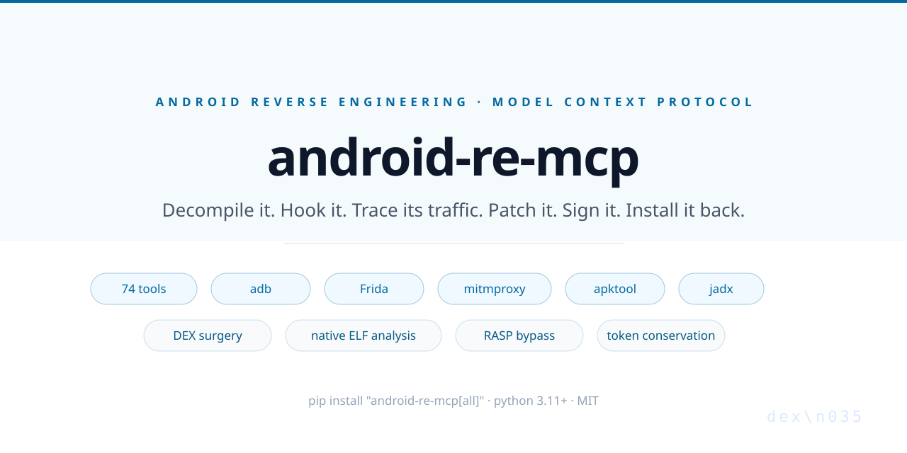

<picture>
  <source media="(prefers-color-scheme: dark)" srcset="docs/social-preview-dark.svg">
  
</picture>

[](https://pypi.org/project/android-re-mcp/) [](https://github.com/FlyPhantomFly/android-re-mcp/actions) [](https://pypi.org/project/android-re-mcp/) [](https://github.com/FlyPhantomFly/dexfile-cli/releases) [](LICENSE)

android-re-mcp is an MCP server for Android reverse engineering. You point it at a real device and a target app, then just ask: *what is this app, what's protecting it, and how do I get past that?* The assistant picks from 74 tools — decompile, hook, trace traffic, dump memory, patch smali or dex, sign and reinstall — and walks you through the answer.

It's one package (PyPI: `android-re-mcp`, command `android-re-mcp`). The old npm half (`mobile-re-mcp`) was retired in 1.4.0 — its static Android tools live on here, its iOS tools are gone, and npm shows the old package as deprecated.

---

## The Python server (the PyPI package)

### What exactly it does

`pip install "android-re-mcp[all]"` gives you an MCP server, started as `android-re-mcp`, that speaks MCP over stdio (or SSE on 127.0.0.1 with a bearer token) and exposes **74 tools over one Android target at a time**:

- **Static work on the APK file itself** — apktool and jadx decompilation, ripgrep searches across the decompiled folder, androguard manifest parsing and bytecode cross-references, apkid packer/obfuscator identification, apkleaks secret scanning, quark-engine behaviour rules (`quark_scan`), and an orchestrator (`apk_analyze_full`) that runs all of those in one call and scores the protection tier.
- **Dynamic work on a running app** — spawn or attach a process with Frida, inject JavaScript, stream script output back, hook SSL pinning, dump and search process memory, trace storage, crypto and network calls from a built-in script collection you can extend with your own scripts.
- **Work on the phone** — list devices, run shell commands, install APKs, pull and push files, capture logcat, mirror the screen with scrcpy, and take screenshots.
- **Network** — start and stop mitmproxy (loopback only), read captured flows as structured JSON, export them as HAR for Chrome DevTools or Burp.
- **Patching and signing** — edit smali in a decompiled folder, embed a Frida gadget so you can hook a non-rooted device, rebuild with apktool and sign with uber-apk-signer using your keystore or the debug one.
- **Native and cross-platform code** — strings/exports/disassembly for `.so` files, Il2CppDumper for Unity, Blutter and engine-version detection for Flutter, Hermes decoding for React Native.
- **Workflow support** — a RASP signature database and ready-made bypass scripts, per-target notes kept across sessions, a self-check of your toolchain, and 12 knowledge packs served as MCP resources and prompts (assessments, bypass escalation ladders, common mistakes).

It is Android only. Several tools change the device (install, push, patch), which is why the guard layer described below checks every call before it runs.

### Install

```bash
pip install "android-re-mcp[all]"
android-re-mcp --setup
```

It needs Python 3.11 or newer. The base install is just the MCP server. The extras pick up the heavy libraries, and you can install parts instead of all:

| Extra | What it adds | Which tools need it |
| --- | --- | --- |
| `[frida]` | frida, frida-tools | every `frida_*` tool, `ssl_kill_switch` |
| `[static]` | androguard, apkid, apkleaks | `manifest_parse`, `analyze_code`, `find_crypto_usage`, `find_urls`, `apk_identify`, `apk_scan_secrets`, `apk_analyze_full` |
| `[network]` | mitmproxy | `mitm_start/stop/read_flows/export_har` |
| `[analysis]` | quark-engine | `quark_scan` (also a best-effort stage of `apk_analyze_full`) |
| `[native]` | capstone | `so_xrefs`, `rop_gadgets` |
| `[all]` | everything above | — |

If Frida is already pinned in your environment, install without extras and the server will not touch it.

`--setup` downloads pinned, checksum-verified copies of apktool 2.12.1, jadx 1.5.6, uber-apk-signer 1.3.0, Il2CppDumper 6.7.46 and dexfile-cli 0.1.2 into `~/tools`. adb comes from your package manager (`sudo apt install adb`); scrcpy and radare2 too. Run `android-re-mcp --setup` again any time to fill in whatever is missing.

### Connect it

Claude Code:

```bash
claude mcp add android-re -- android-re-mcp
```

opencode, in `~/.config/opencode/opencode.json`:

```json
{
  "mcp": {
    "android-re": { "type": "local", "command": ["/path/to/venv/bin/android-re-mcp"], "enabled": true }
  }
}
```

Claude Desktop, in `claude_desktop_config.json`:

```json
{
  "mcpServers": {
    "android-re": { "command": "/path/to/venv/bin/android-re-mcp" }
  }
}
```

Use the full path to the command if it lives in a virtualenv. Any other client needs only the command, with no arguments. stdio is the default transport; `--transport sse --port 8765` also works, listens on 127.0.0.1 only, and any other `--host` needs `ANDROID_RE_MCP_TOKEN`, which clients send as a bearer token.

Start with a check of what you have: ask "Run check_tools", and the assistant lists which tools it found (with versions) and which are missing, with install hints. On a set-up machine nearly everything reports available — only the optional extras you skipped show as missing.

### A first session

Ask in plain language, and the assistant picks the tools. Some prompts and what they use:

- "Check my devices and get frida-server onto the phone." (`adb_devices`, `frida_server_push`)
- "Decompile /home/me/apks/app.apk and search the strings for token or secret." (`apk_decompile`, `search_strings`)
- "What is this app, which framework, what protection does it use, and how bad is it overall?" (`apk_analyze_full`)
- "Which protection does com.example.app use, and how do I get past it?" (`rasp_identify`, `rasp_bypass`)
- "Track this app's network traffic." (`mitm_start`, then `adb reverse tcp:8080 tcp:8080`, open the app, `mitm_read_flows`, `mitm_export_har`)
- "Bypass SSL pinning in com.example.app and watch the requests." (`ssl_kill_switch` or a `frida_run_script` of `ssl_pinning_universal`)
- "Patch the license check in the smali, rebuild, sign and install it." (`smali_patch`, `apk_rebuild_sign`, `adb_install`)
- "Swap one string in classes.dex without rebuilding the whole APK." (`dex_extract`, `dex_patch`, `dex_swap`, `apk_sign`, `adb_install` — the dex-only fast loop: no apktool resource decode, no resource rebuild)
- "Dump the app's memory and find the session key." (`frida_attach`, `frida_find_bytes`, `frida_memdump`)

The server also carries seven guided prompts (`master-workflow`, `first-look`, `rasp-assess`, `bypass-ssl`, `bypass-root`, `bypass-frida`, `stuck`) and keeps per-app notes so a later session can pick up where the last one stopped (`memory_read`, `memory_write`).

### The tool set

Every tool returns structured JSON with a `status` field (`ok`, `error`, `missing_tool`) — your assistant can chain calls. File arguments are absolute paths validated by the guard. `apk_decompile` and `apk_decompile_java` land next to the APK (`<name>_apktool/`, `<name>_jadx/`); dumps and captures go to the private data folder.
Heavy list outputs are token-conserved: a search, a strings dump, logcat and Frida script output are capped per call (default 200 lines, `ANDROID_RE_MCP_MAX_OUTPUT_LINES`) with the honest total kept and an actionable narrowing hint, so one call can't flood the model's context.

**Static analysis (11)**

| Tool | What it does | Needs |
| --- | --- | --- |
| `apk_decompile` | apktool decompile (smali + resources), or resources/smali only via `mode` | apktool |
| `apk_decompile_java` | jadx decompile to Java source; falls back to apktool (smali) when jadx is unavailable, flagged with `engine` + note | jadx (apktool fallback) |
| `apk_identify` | apkid: packers, obfuscators, compilers, anti-tamper | apkid |
| `apk_scan_secrets` | apkleaks: hardcoded keys and credentials, report saved as JSON | apkleaks |
| `apk_analyze_full` | runs apkid + apkleaks + manifest + quark in one call, adds framework guess and protection tier | apkid, apkleaks, androguard, (quark-engine) |
| `apk_diff` | two builds side by side: identity/SDK levels, security flags, permission and exported-component deltas, native-library sha256 changes, optional secret deltas, archive inventory | androguard (manifest section); everything else stdlib |
| `android_api_extractor` | Retrofit HTTP annotations, const-string URLs (deduped, host-grouped) and detected OkHttp3 client fields from smali, as a list or a ready-to-import Postman v2.1 collection | apktool (when given `apk_path`; `smali_dir` skips it) |
| `android_google_services` | Google/Firebase config: bundled `google-services.json`, ten known keys from `res/values/strings.xml` (`smali_dir`), or a Google-pattern scan of `resources.arsc` | stdlib (`smali_dir` for the strings.xml path) |
| `quark_scan` | quark-engine behaviour rules: scored matches like "send SMS" or "load dex from external source"; `keywords` filters, the rule set comes from `freshquark` or `rules_dir` | quark-engine |
| `manifest_parse` | androguard: package, versions, SDK levels, exported components, permissions, debuggable/allowBackup flags; `categorize_permissions` adds a dangerous/normal split with per-permission reasons and a risk summary | androguard |
| `search_strings` | ripgrep with JSON output over any folder (a decompile, a dump, a HAR); capped per call with the honest total kept | ripgrep |

**Bytecode deep-dive (3)**

| Tool | What it does | Needs |
| --- | --- | --- |
| `analyze_code` | cross-reference callers/callees for classes and methods | androguard |
| `find_crypto_usage` | list every javax.crypto / java.security call site and which API it uses | androguard |
| `find_urls` | all URLs and hostnames from bytecode constants and assets, sorted into api/auth endpoints | androguard |

**Frida sessions (6)**

| Tool | What it does | Needs |
| --- | --- | --- |
| `frida_spawn` | spawn an app with Frida and optionally inject a script | frida, rooted device or gadget |
| `frida_attach` | attach to an already-running process | same |
| `frida_inject` | inject another script into the live session | active session |
| `frida_read_output` | drain what the hooking session printed (capped per call; the rest stays buffered) | active session |
| `frida_detach` | detach cleanly | active session |
| `frida_status` | frida version, devices, server responsiveness, current session state — the "am I attached?" no-op read | frida |
| `objection_run` | run any objection command against a package | objection |

**Frida script library (3)**

| Tool | What it does | Needs |
| --- | --- | --- |
| `frida_list_scripts` | list available hook scripts by category (ssl_pinning, root_detection, crypto, memory, hooks, storage, network), including your own | nothing |
| `frida_get_script` | read the JS source of a named script (8 ship with the package; yours override) | nothing |
| `frida_run_script` | spawn + inject a named built-in script in one call, with config sent as `{'type':'config', …}` after load | frida |

The 7 Java-hooking scripts ship as pre-built bundles with `frida-java-bridge` compiled in — frida 17 removed the `Java` global from script runtimes, so raw sources would die with `ReferenceError` on every modern client (`memory_scan` is pure-native and ships as-is). Rebuild them with `python/src/android_re_mcp/frida_scripts/build_bundles.sh` after editing the raw sources in that folder's `src/`. For a stealth frida-server (renamed binary on a non-default port), set `ANDROID_RE_MCP_FRIDA_ENDPOINT` (below).

**Anti-detection (2)**

| Tool | What it does | Needs |
| --- | --- | --- |
| `frida_server_push` | push a frida-server (or the hluda/StrongR fork) matching your frida-tools version to the device | adb, frida-tools, binary in `~/tools` |
| `frida_spawn_hluda` | spawn through the renamed hluda server so Frida port/name scans come up empty | hluda server running on the device |

**Process memory (2)**

| Tool | What it does | Needs |
| --- | --- | --- |
| `frida_memdump` | dump every rw- memory region of the target to disk files | active session |
| `frida_find_bytes` | search process memory for a UTF-8 string or hex pattern, with addresses | active session |

**Device control (12)**

| Tool | What it does | Needs |
| --- | --- | --- |
| `adb_devices` | list devices with serial and state | adb |
| `adb_shell` | run a shell command on the device (split on the host, safely) | adb |
| `adb_install` | install an APK (`install -r -t`) | adb |
| `adb_pull` / `adb_push` | copy files between host and device | adb |
| `adb_logcat_start` / `read` / `stop` | stream and buffer up to 50k log lines in the background; reads are capped per call (`ANDROID_RE_MCP_MAX_OUTPUT_LINES`) | adb |
| `adb_ui_dump` | the current UI as structured elements (class, text, resource-id, bounds, clickable) | adb |
| `hermes_decode` | extract and decode the React Native Hermes bundle to readable JS | hermes-dec or hbctool |
| `scrcpy_start` | mirror the device screen, optionally recording to MP4 | scrcpy |
| `scrcpy_screenshot` | capture a PNG of the current screen | adb only |

**Network (5)**

| Tool | What it does | Needs |
| --- | --- | --- |
| `mitm_start` | start mitmdump bound to 127.0.0.1, write a `.mitm` capture | mitmproxy |
| `mitm_stop` | stop it, report the capture path | — |
| `mitm_read_flows` | parse the capture into JSON: method, URL, bodies, status | mitmproxy |
| `mitm_export_har` | export the capture as HAR for DevTools/Burp | mitmproxy |
| `ssl_kill_switch` | inject the ssl-kill-switch2 script (OkHttp, TrustKit, native SSL) into a running app | frida |

**Patching and signing (4)**

| Tool | What it does | Needs |
| --- | --- | --- |
| `smali_patch` | replace text or regex in one smali class, optionally scoped to one method; keeps a `.bak` | a decompiled folder |
| `inject_gadget` | full 6-step Frida-gadget embed: decompile, copy .so, write config, patch loadLibrary, rebuild, sign | apktool, java, gadget .so in `~/tools/gadgets` |
| `apk_sign` | sign with uber-apk-signer (debug keystore or your `[signing]` config) | java, signer jar |
| `apk_rebuild_sign` | apktool build + sign in one step | apktool, java, signer jar |

**Native libraries (4)**

| Tool | What it does | Needs |
| --- | --- | --- |
| `native_strings` | strings from a `.so` or all libs in an APK, filtered to interesting ones | strings (or pure-Python fallback) |
| `native_exports` | exported symbols per library | readelf/nm (or built-in ELF parser) |
| `native_disasm` | radare2 disassembly of a function (asm, graph or pseudocode) | radare2 |
| `il2cpp_dump` | Unity: dump.cs + script.json from libil2cpp.so + global-metadata.dat | Il2CppDumper |

**Native ELF security & code search (5)** — added in the capstone integration review

| Tool | What it does | Needs |
| --- | --- | --- |
| `elf_checksec` | checksec for an ELF: PIE, NX, RELRO, canary, fortify, RUNPATH | nothing (pure Python) |
| `so_xrefs` | scan-based xrefs to an address in a .so: branches, adrp+add pairs, movz/movk immediates (literal pools/GOT not followed) | capstone |
| `rop_gadgets` | ROP gadget search ending in ret/bx/jmp-reg; `depth` bounds runs, `filter` narrows (the cap hint names it) | capstone |
| `native_crypto_constants` | AES s-box, SHA-256/512 IVs, MD5 T-table, CRC-32, TEA delta, Base64 alphabets, Blowfish P-array — file offset + VA | nothing |
| `syscall_lookup` | arm64/x86_64 syscall number ↔ name, bundled from kernel headers | nothing |

**DEX surgery (7)** — added in the DexFile integration review ([dexfile-cli 0.1.2](https://github.com/FlyPhantomFly/dexfile-cli))

| Tool | What it does | Needs |
| --- | --- | --- |
| `dex_info` | version, target API, class/method/string counts, class list; magic-scans flat dex, 041 containers and wrapped cdex/dex (vdex/packer blobs) | dexfile-cli.jar, java 17+ |
| `dex_extract` | pull every `classes*.dex` out of an APK (041 containers split per part) | dexfile-cli.jar |
| `dex_convert` | read any version → write the target (old-ART vdex/cdex → 035 for jadx; 035 → 041 container) | dexfile-cli.jar |
| `dex_patch` | surgical dex-model edits: `replace-const-string`, `rename`, `retarget-invoke`, `flip-flags`, `replace-method-body` (smali text); `.bak` on first in-place modify; per-op matched counts | dexfile-cli.jar |
| `dex_assemble` | one smali class → dex (`SmaliIO`; the text must carry `.locals` and `.end method`) | dexfile-cli.jar |
| `dex_split` | shard a class list across dex files under the 64K-reference limit (`DexIO.balanceAll`) | dexfile-cli.jar |
| `dex_swap` | swap a patched dex back into an APK copy, other entries byte-identical (pure Python, no jar) | nothing |

**Flutter / Dart (3)**

| Tool | What it does | Needs |
| --- | --- | --- |
| `flutter_version` | engine commit hash + SDK/Dart version fingerprints from libflutter.so | nothing |
| `dart_snapshot_info` | AOT/JIT snapshot kind; warns when the ELF header was wiped (zShield) | nothing |
| `blutter_extract` | Blutter run on libapp.so: class/method symbols, asm, pseudo-code for IDA/Ghidra | blutter clone |

**RASP assessment (2)**

| Tool | What it does | Needs |
| --- | --- | --- |
| `rasp_identify` | vendor fingerprinting (Guardsquare, Arxan, Promon, Zimperium, custom) from APK entry names and apkid, plus a full native-library inventory: per-ABI ELF listing, known packer/RASP/framework/SDK/runtime identification, stripped/packed section-table signals | optional apkid |
| `rasp_bypass` | returns a ready Frida script for vendor + protection (root, SSL, Frida detection, integrity, emulator) | nothing |

**Per-target notes (2)** and **Setup (2)**

| Tool | What it does | Needs |
| --- | --- | --- |
| `memory_read` / `memory_write` | session notes per package, pre-seeded with a findings template so follow-up sessions can resume | nothing |
| `check_tools` | full inventory of your toolchain with versions, paths, install hints and the MCP tools that use each entry (`used_by`); pip CLIs are probed as executables, and the `medusa` entry refuses the SSH-cracker namesake | nothing |
| `install_tool` | install a missing tool from a pinned SHA-256-checked download, pip or npm; `medusa`/`fridump` deliberately have no auto-recipe (name-collision / unused) | off unless `ANDROID_RE_MCP_ALLOW_INSTALL=1` |

### Knowledge packs and prompts

Five MCP **resources**: `knowledge://detection-patterns` (root/Frida/emulator/integrity checks and their counters), `knowledge://bypass-playbooks` (escalation ladders), `knowledge://framework-fingerprints` (React Native, Flutter, Unity, Xamarin from artefacts), `knowledge://crypto-patterns` (hardcoded keys, weak IVs, insecure ciphers) and `knowledge://common-mistakes`. Seven MCP **prompts** wrap the same packs: `master-workflow`, `first-look`, `rasp-assess`, `bypass-ssl`, `bypass-root`, `bypass-frida`, `stuck`. Your client's prompt picker lists them; they cost nothing to call.

Eight bypass/monitor scripts ship with the package (`ssl_pinning_universal`, `root_detection_bypass`, `frida_detection_bypass`, `crypto_monitor`, `memory_scan`, `method_tracer`, `storage_monitor`, `network_monitor`) — every one accepts live config: post or send `{type:'config', ...}` (UPPER-case keys as shown by `frida_list_scripts` usage strings; lowercase accepted too). Drop your own script into `~/.local/share/android-re-mcp/frida_scripts` using the same catalogue filename and yours is used instead of the shipped one.

### Files and settings

- Notes, captures and scratch files: `~/.local/share/android-re-mcp` (`ANDROID_RE_MCP_HOME` to move; created `0700`)
- Your settings: `~/.config/android-re-mcp/config.toml` (`ANDROID_RE_MCP_CONFIG`) — today just `[signing]` keystore paths and passwords
- Downloaded tools: `~/tools` (`ANDROID_RE_MCP_TOOLS_DIR`); subfolders (jadx, platform-tools, il2cppdumper, scrcpy) are appended to the server's PATH if present
- `ANDROID_RE_MCP_ALLOWED_DIRS` — folders (separated by `:`) that all file arguments must stay inside
- `ANDROID_RE_MCP_DISABLE_TOOLS` — comma-separated tools to switch off, e.g. `adb_shell,adb_push,adb_pull`
- `ANDROID_RE_MCP_MAX_OUTPUT_LINES` — per-call cap for heavy list outputs (default 200; `0` disables) — the total stays honest and the result names how to narrow
- `ANDROID_RE_MCP_ALLOW_INSTALL=1` — the only way `install_tool` becomes callable over MCP (`--setup` always works)
- `ANDROID_RE_MCP_FRIDA_ENDPOINT=127.0.0.1:31337` — connect every `frida_*` tool to a remote frida-server instead of USB discovery. For a stealth setup (renamed server binary on a non-default port, reached via `adb forward tcp:31337 tcp:31337`) USB discovery finds nothing — this is the switch that makes the dynamic tools work against it.

### Staying safe

This server runs commands on your phone and your computer, so treat its tools with care.

- Every call passes the guard first: file arguments reject a leading `-`, NUL bytes, and protected locations (`~/.ssh`, `~/.config/gh`, shell rc files, keyrings, …); `package`, `serial`, `port` and similar arguments are pattern-checked; writes into `/etc` are refused.
- The stateful tools (`frida_spawn`, `adb_shell`, `adb_install`, `mitm_*`, signing) change a real device — set them to ask first in your client, and keep `ANDROID_RE_MCP_DISABLE_TOOLS` around anything you do not want reachable.
- mitmproxy listens on 127.0.0.1. Run `adb reverse tcp:8080 tcp:8080` and point the phone's proxy at 127.0.0.1:8080.
- SSE transport is loopback-only unless you set `ANDROID_RE_MCP_TOKEN`; foreign Host headers are rejected.
- Downloads are pinned to a release and SHA-256-verified. Scratch files live in a private `0700` folder, never `/tmp`.
- A sample you analyze can try to steer the assistant through its own strings and symbol names. Use a VM for hostile samples, and do not auto-approve tools that touch the device.

---

## The npm server (retired)

The npm package `mobile-re-mcp` was retired in 1.4.0 — its static Android tools live on in this package, its iOS tools are gone, and npm shows the old package as deprecated with a pointer here. Old releases stay on npm and in the git history (the server lived under `src/` before 1.4.0). Install this package instead.

---

## Companion servers

Some capabilities are deliberately kept out of this package and paired with it as separate MCP servers — the token cost stays opt-in per project, and each tool keeps its own release cycle.

**smali-lsp** ([github.com/surendrajat/smali-lsp](https://github.com/surendrajat/smali-lsp)) — a Language-Server-grade smali engine (224 Dalvik opcodes, inheritance-aware indexing) with a built-in MCP mode. It is the semantic layer this package deliberately does not reimplement: references, call graphs, workspace symbol search and — most valuably — `smali_diagnostics`, which reports *what the assembler or verifier would reject after a hand edit*. Wire it into the patching loop so a bad edit fails before `apk_rebuild_sign` burns a rebuild:

```
apk_decompile → smali_index → smali_patch edits → smali_diagnostics → apk_rebuild_sign
```

Build it once (JDK 17+, `./gradlew shadowJar`) or grab an upstream release, then register it as its own server — it needs an apktool decompile, which `apk_decompile` already produces (`<name>_apktool/`):

```bash
claude mcp add smali-lsp -- java -jar /path/to/smali-lsp.jar mcp
```

```jsonc
// opencode / Claude Desktop config
{ "smali-lsp": { "type": "local", "command": ["java", "-jar", "/path/to/smali-lsp.jar", "mcp"], "enabled": true } }
```

Its 14 tools add roughly 0.7k tokens of catalog when enabled — leave it off for sessions that never touch smali. The other integrations came from the same consolidation reviews: the native-ELF suite and the dex surgery are pinned-jar or in-package tools here (the full capstone server was rejected — 25 tools for mostly duplicative capability), all documented in `docs/code-review-and-extensions.md`.

---

## Working on it

The Python server lives in [`python/`](python) with its own README, config and tests. [CONTRIBUTING.md](CONTRIBUTING.md) explains how to add a tool or a detection pattern, [SECURITY.md](SECURITY.md) is for reporting vulnerabilities, and [CHANGELOG.md](CHANGELOG.md) lists what changed. [docs/code-review-and-extensions.md](docs/code-review-and-extensions.md) documents the current function of the server, findings from a full review, and the proposed extensions.

## License

MIT. © 2026 FlyPhantomFly.
